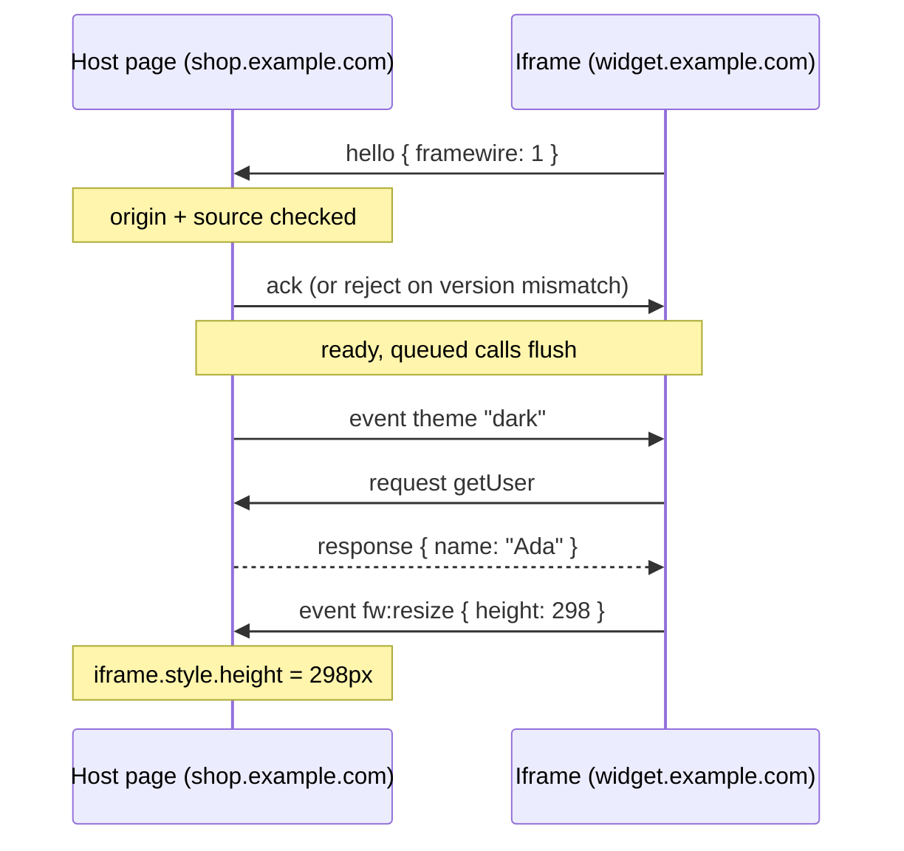

# framewire

[](https://github.com/NwosaEmeka/framewire/actions/workflows/ci.yml)
[](https://www.npmjs.com/package/framewire)

Typed, tiny messaging between a host page and the iframe it embeds.

**Docs and demo:** https://framewire.vercel.app

## The problem

If your frontend runs inside other people's websites (a booking widget, a
checkout, a chat box), an iframe is the only boundary that keeps their CSS and
scripts out of yours. But then every interaction crosses `postMessage`: untyped,
fire-and-forget, easy to get wrong on origins, blind to whether the other side
is listening, and no help with sizing or with payment pages that refuse to be
framed. framewire is that missing layer, in under 3 KB.

## Usage

```bash
npm i framewire
```

```ts
// host page
const bridge = createHost<App>({ iframe, origin: 'https://widget.example.com', resize: true });
bridge.handle('getUser', () => currentUser);
bridge.on('booked', ({ slot }) => toast(`Booked ${slot}`));

// inside the iframe
const bridge = createFrame<App>({ allowedOrigins: ['https://shop.example.com'], resize: true });
const user = await bridge.request('getUser'); // typed, with a timeout
bridge.emit('booked', { slot: '09:00' });
```

`App` is one shared type describing the events and methods on each side. See the
[quick start](https://framewire.vercel.app/docs/quick-start).

No build step? One tag mounts the iframe and wires the bridge:

```html
<script
  src="https://cdn.jsdelivr.net/npm/framewire/dist/framewire.global.js"
  data-src="https://widget.example.com/book"
></script>
```

## How it works



## Features

- **One contract, both sides typed:** events, request arguments and results.
- **Strict origins:** exact origin + source window on every message;
  wildcards rejected; nothing sent to `*` after the handshake.
- **Versioned handshake:** works whichever side loads first; mismatched
  protocol versions fail loudly.
- **Requests with timeouts:** `TIMEOUT`, `NO_HANDLER`, `REMOTE_ERROR` instead
  of hanging promises. Calls before the handshake are queued.
- **Auto-resize:** the frame reports its height with `ResizeObserver`; the
  host applies it with `minHeight` / `maxHeight`.
- **`navigateTop` + resume:** for checkout and OAuth pages that refuse to run
  in a frame. Host opt-in, http(s) only, state handed back on return.
- **Script-tag loader** for Wix, Webflow and WordPress.
- **Zero dependencies.** ESM, CJS, IIFE and types.

## Size

Minified + gzipped, as measured by `pnpm size`. CI fails any entry over 3 KB.

| Entry                       | Size    | Use                      |
| --------------------------- | ------- | ------------------------ |
| `framewire/host`            | 2.38 KB | host page                |
| `framewire/frame`           | 2.46 KB | embedded page            |
| `framewire`                 | 2.98 KB | both sides               |
| `framewire.global.js`       | 2.76 KB | script-tag loader (host) |
| `framewire.frame.global.js` | 2.49 KB | script tag (frame)       |

## Browser support

| Browser                 | Status                                                      |
| ----------------------- | ----------------------------------------------------------- |
| Chrome, Edge (Chromium) | Tested: e2e across three origins in CI                      |
| Safari (WebKit)         | Tested: e2e across three origins in CI                      |
| Firefox                 | Expected to work (standard APIs only); not tested in CI yet |

Requires ES2020. Auto-resize needs `ResizeObserver`; resume needs
`sessionStorage` and degrades to "no resume" without it.

## Security notes

- Both sides must name each other's origin. A frame predicate like `() => true`
  turns origin checks off.
- `navigateTop` is off unless the host opts in. `javascript:`, `data:` and other
  non-http(s) URLs are always refused.
- Resume state lives in the host's `sessionStorage`. Store an id, not a secret.

## Development

```bash
pnpm i
pnpm test        # unit + type tests (Vitest)
pnpm e2e         # Playwright, Chromium + WebKit, three local origins
pnpm size        # gzip budget
pnpm --filter docs dev
```

## License

[MIT](./LICENSE)
